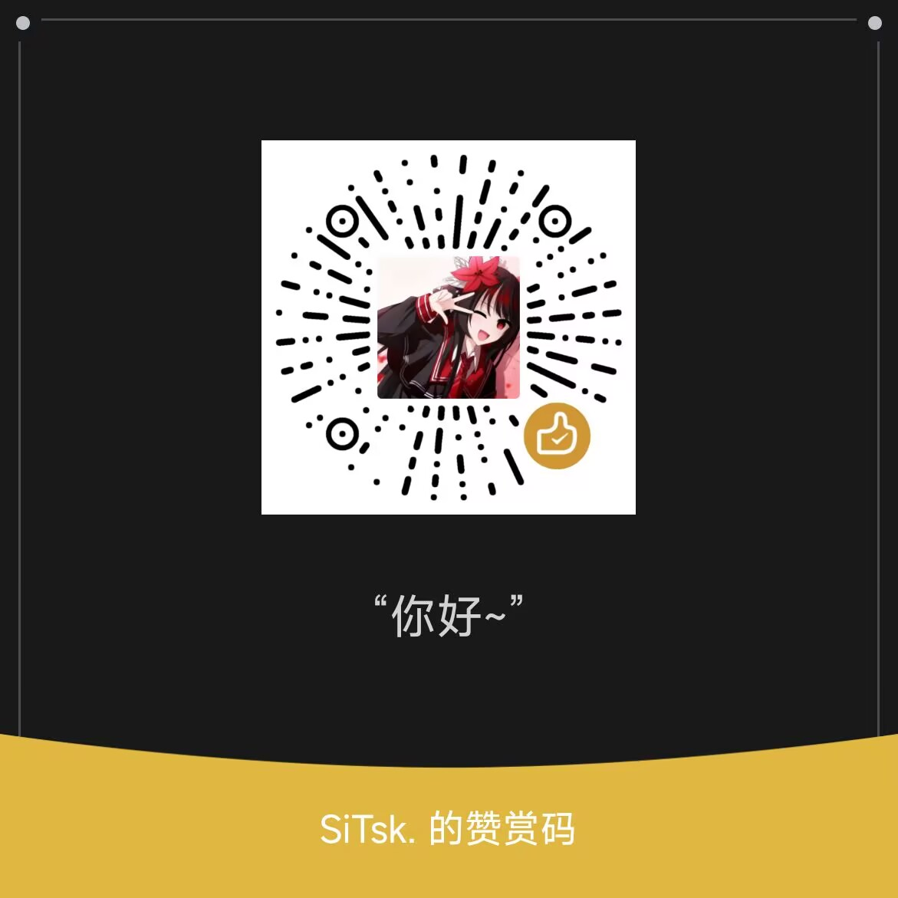

# Data A Live

在小米 17 Pro（代号 pandora，骁龙 8 Elite Gen 5，SM8850）上直接跑 iPhone X 的 iOS 16.7.16。内核是自己编译的苹果开源内核 xnu-8796，这台手机的硬件驱动以补丁的形式编进内核。项目以前叫 `ios-pandora`。

> Runs iPhone X's iOS 16.7.16 directly on the Xiaomi 17 Pro (pandora, SM8850) with a self-built xnu-8796 kernel. Experimental; the documentation is in Chinese. Formerly `ios-pandora`.

这是实验项目，还没法日常使用。仓库里只有内核补丁、驱动源码和工具，没有苹果的系统文件，也没有高通和小米的固件。

## 现在的状态

截至 2026-10-28。

| 部分 | 状态 |
|---|---|
| 启动 | 测试时用电脑 `fastboot boot` 临时启动，只在内存里，重启回安卓。也可以装开机菜单（写一次 boot_b），开机倒数时按音量上进 iOS，见 [bootmgr/README.md](bootmgr/README.md)。iOS 的根文件系统是安卓数据分区里一个位置固定的 16 GiB 文件，不用清数据，也不改分区表 |
| 锁屏、主屏幕、自带应用 | 能进、能开。在多任务界面划掉应用时，偶尔整个界面会有几秒点不动，原因还在查 |
| 触摸、电源键、音量键、亮度 | 能用 |
| 画面（Adreno 840） | 整个系统界面由 GPU 合成。GPU 内核驱动是自己写的，Vulkan 用 Mesa 的 Turnip，Metal 用 UniXNU 的 NativeMetal 插件加我们改过的 metal2vulkan 翻译层。显示控制器直接读 GPU 画好的图。120 Hz 屏上滑动平均约 110 帧，再往上被 GPU 温度限住 |
| CPU | 8 个核都用上，按负载调频，空闲的核会休眠 |
| 温度 | 现在只按芯片温度降频（核心到 105 ℃ 才开始），用几分钟机身就很烫。安卓用 6 个板上热敏电阻和电池温度算出机身温度，从 35 ℃ 左右开始逐档降频。我们在照安卓的做法改 |
| 电池 | 电量、电压、电流、温度和充电状态都读电量计的真实值，百分比按安卓的算法换算 |
| 声音 | 音频 DSP 能启动并通信，固件从手机自己的分区读。两颗功放的固件能载进去，但喇叭那条数字音频线还没开起来，功放的 DSP 不运行，所以没有声音 |
| USB | 只能充电。接电脑没有数据功能，传不了文件，iTunes 和 usbmuxd 也用不了。正在做 USB 串口，用来实时看内核日志 |
| Wi-Fi、蜂窝网络、相机、背屏 | 不能用。iOS 的相机依赖 A11 的 ISP 和苹果的私有接口，接不到高通的相机硬件上 |
| App Store 应用 | 基本不能用，应用解密要靠苹果芯片里的安全模块 |

其他已知问题：

- 开机慢。苹果的系统共享缓存按 16K 页签名，我们的内核用 4K 页，所以每次开机都要把约 3.3 GB 的共享缓存重新核对一遍。现在用上了 ARMv8 的 SHA 指令，也还要 9 秒左右。
- 省电基本没做。GPU 开机后一直保持上电，熄屏也不断电。
- Metal 翻译层还有没覆盖到的格式和用法，碰到的界面会少画一部分。

详细进度在 [PLAN.md](PLAN.md)，GPU 部分在 [docs/GPU_PLAN.md](docs/GPU_PLAN.md)，喇叭的调查在 [docs/SPEAKER_RESEARCH.md](docs/SPEAKER_RESEARCH.md)。

## 怎么启动

没有现成的镜像可以下载，内核和系统镜像都要自己做。需要准备：

- 小米 17 Pro，bootloader 已解锁，安卓里有 root（Magisk）。
- 自己从苹果下载的 iPhone X（iPhone10,3 / iPhone10,6）iOS 16.7.16 IPSW。
- Windows 上的 Git Bash（用 adb、fastboot），以及 WSL2 的 Ubuntu 24.04（编译、做镜像）。

大致流程：

1. 编内核。可以用 GitHub Actions 的 `xnu.yml`，也可以在 WSL 里用 `wsl/local_build.sh` 只重编改过的文件。
2. 用 IPSW 做一个 16 GiB 的 HFS+ 根文件系统镜像。做镜像的脚本沿用 ios-fuxi 的 `mkiosroot.sh`，本仓库没带；WSL 内核缺的 hfsplus 模块用 `wsl/prep_root_tools.sh` 编。
3. 在安卓里用 `tools/pinfile` 建三个位置固定的文件，分别放根文件系统、内核日志和固件包，再把镜像写进去。
4. 运行 `tools/boot_ios.sh`。它会核对这几个文件在存储上的位置，生成硬件描述（ADT）和启动镜像，让手机进 fastboot 后 `fastboot boot`。
5. 想不接电脑也能进 iOS，再按 [bootmgr/README.md](bootmgr/README.md) 装开机菜单。

平时测试用 `tools/gpu_test.sh`：它启动 iOS，跑够指定的秒数后让手机自动重启回安卓，再把内核日志从手机里读出来。

## 目录

| 目录 | 内容 |
|---|---|
| `xnu/patches/` | 对 xnu-8796 的补丁，按编号顺序应用。前面一部分来自 ios-sweet 和 ios-fuxi，`pandora` 开头的是这台手机专用的 |
| `wsl/` | 编进内核的驱动源码（GPU、显示、触摸、按键、存储、固件包、音频 DSP、功放、电池、温度传感器等），以及生成补丁、本地编译用的脚本。`wsl/qcom/` 是从 UniXNU-sheng 原样拷来的 SMEM、SMP2P、GLINK、GPR、FAT 代码 |
| `shim/` | `fastboot boot` 启动的小程序。`loader` 代替 iBoot 把内核拉起来，`hello` 是最早的硬件探测程序 |
| `bootmgr/` | 开机菜单。写进 boot_b 一次，以后换 iOS 只换菜单里的 iOS 格子 |
| `tools/` | 启动镜像、设备树、固件包、信任缓存的生成工具，真机测试脚本，GPU 测试程序（vktest、pgputest、mtltest），主机上跑的单元测试（`tools/hosttest/`） |
| `tools/turnip/`、`tools/metal/` | 在 GitHub Actions 上为 iOS 16 交叉编译 Turnip 和 NativeMetal 插件 |
| `docs/` | GPU 移植计划、对照笔记、喇叭调查 |
| `device/` | 只放说明文档，设备导出的原始数据不进仓库 |
| `.github/workflows/` | 内核（`xnu.yml`）和 GPU 用户态（`turnip.yml`）的自动编译 |

## 和 ios-sweet、UniXNU 的关系

本项目走 [ios-sweet](https://github.com/dipa-studio/ios-sweet) 的路线：在骁龙手机上原生跑 iPhone X 的 iOS 16，驱动直接编进 xnu 内核，以补丁维护（`xnu/patches/`）。前面一部分补丁来自 ios-sweet 和 [ios-fuxi](https://github.com/bangprovn/ios-fuxi)。

GPU 部分用了 UniXNU 的组件：NativeAdreno 的用户接口、ArmSmmu4K、Metal 插件 NativeMetal 和配套的 Turnip 补丁。UniXNU 跑的是 iPadOS 17，有自己的构建系统，驱动是独立模块；本仓库跑 iOS 16，驱动编进内核，所以它和 UniXNU 的机型仓库（`UniXNU-<机型>`）是分开的两套。按 UniXNU 的[贡献指南](https://unixnu.com/zh/contributing/repository)加了 `unixnu` 话题。

以后会把对别人有用的驱动拆成独立仓库，先从 Adreno 840 的 GPU 驱动开始，本仓库再用子模块引用它们。

## 安全

- 测试启动都用 `fastboot boot`，只在内存里，重启就回安卓。
- 会写分区的只有开机菜单：安装时写一次 boot_b，以后换 iOS 只改写 boot_b 里的 iOS 格子。原装的安卓内核原样留在 boot_b 里，其他分区不动。要撤销，把你自己备份的原装 boot_b 刷回去。
- iOS 只读写它自己的那几个固定文件。内核的存储驱动只认这些文件占用的存储块，超出范围的读写一律拒绝；不加 `ufsrw=1` 时完全只读。
- 仓库里不放苹果的系统文件（IPSW、dyld 共享缓存、SDK）、高通和小米的固件、分区备份、设备导出和日志，`.gitignore` 挡住了这些目录。
- 动手前先完整备份手机，出了问题后果需要自己承担。

## 致谢

- [ios-sweet](https://github.com/dipa-studio/ios-sweet)：在红米 Note 10 Pro（SM7150）上原生跑 iOS 16，前面的内核补丁和启动方式都基于它。
- [ios-fuxi](https://github.com/bangprovn/ios-fuxi)：ios-sweet 在小米 13（骁龙 8 Gen 2）上的移植。命令模式屏幕的处理，以及把 iOS 根文件系统放进安卓数据分区里一个固定文件的做法，都参考了它。
- [UniXNU](https://github.com/UniXNU/UniXNU)：4K 页内核、存储驱动，以及 NativeAdreno、NativeMetal、ArmSmmu4K 等 GPU 组件；[UniXNU-sheng](https://github.com/UniXNU/UniXNU-sheng) 的 SMEM、SMP2P、GLINK、GPR、FAT 读取代码。
- [Mesa](https://gitlab.freedesktop.org/mesa/mesa)（Turnip Vulkan 驱动）、[metal2vulkan](https://github.com/steelbrain/metal2vulkan)（Metal 着色器翻译）。
- Linux 内核里的高通驱动（msm/Adreno、时钟、SPMI、ADC、GPI、I2C 等）：寄存器和启动顺序都参考了它们。

## 支持开发

开发很费钱和时间的呜呜呜，全部的打赏将会用于之后的维护以及本人购买 [In Falsus](https://store.steampowered.com/app/3971950/)。

打赏与苹果公司无关，不购买任何软件，也没有付费功能或付费版本；本项目永远不提供苹果的系统文件。

## 许可证

内核补丁和编进内核的源码使用 APSL 2.0（与 xnu 相同）；其余本项目的代码和文档使用 MIT；第三方文件保留各自的许可证。详见 [LICENSE](LICENSE)。
